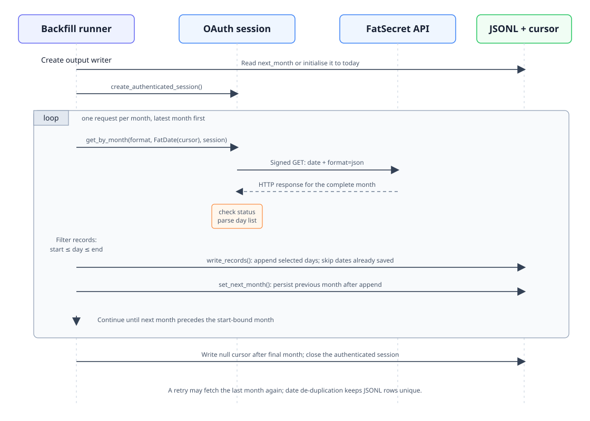
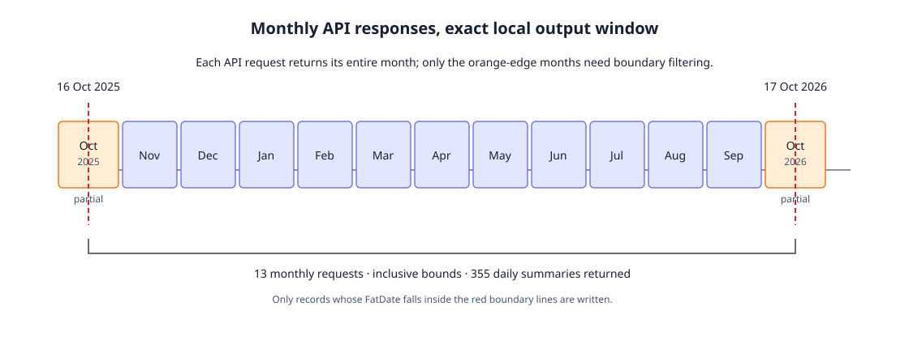

# FatSecret Records Backfill: Execution Debrief

**Run:** 17 October 2026  
**Requested window:** 16 October 2025–17 October 2026, inclusive  
**Result:** 355 unique daily records saved as JSON Lines  
**Scope:** This describes the bounded one-off run, not a new public date-range API.

## What ran

The request was for the past year and a day. The run used `date.today() - 366 days`
as its lower bound and today as its upper bound. The endpoints are inclusive; this
is 366 elapsed days between the bounds, or 367 possible calendar dates.

FatSecret's monthly endpoint returns an entire month's daily summary. Therefore,
the run requested each of the 13 months intersecting the window, from October 2025
through October 2026, then discarded returned days outside the exact bounds.

The existing [`get_all()`](../src/weight_up/fatsecret/get_records.py) was not used:
it deliberately backfills to the FatSecret epoch (1 January 1970), rather than
stopping at a caller-selected lower date. The bounded run used `get_by_month()`
inside a short orchestration loop, reusing one authenticated session and the
existing JSONL writer.



*Figure 1. One authenticated session is reused for all monthly calls. Each result is
date-filtered, appended, then the next-month checkpoint is advanced.*



*Figure 2. The API returns complete months; the first and last monthly responses are
clipped to the requested range.*

## Code path and responsibilities

| Step | Function or method | What it did |
|---|---|---|
| Credentials | [`create_authenticated_session()`](../src/weight_up/fatsecret/auth.py) | Reads the four required credentials from the environment and creates an OAuth 1.0 `OAuth1Session` using HMAC-SHA1 query signing. `auth.py` loads `.env` when imported. |
| Month loop | one-off orchestration script | Starts at today, requests a month, filters to the requested inclusive date range, writes it, then moves to the previous month. It stops after requesting the month containing the lower bound. |
| Month request | [`get_by_month()`](../src/weight_up/fatsecret/get_records.py) | Validates `response_format`; accepts the reusable session so it does not create a new OAuth session for each month. |
| HTTP request | [`_get_month()`](../src/weight_up/fatsecret/get_records.py) | Converts the requested Gregorian date to integer days since 1970-01-01, sends `GET /rest/food-entries/month/v1` with `date` and `format=json`, applies a 30-second timeout, and raises for an unsuccessful HTTP response. |
| JSON parsing | [`_json_to_fatrecords()`](../src/weight_up/fatsecret/get_records.py) | Reads `month.day`, accepting a list, a single object, or an absent/empty day collection. |
| Record conversion | [`_json_to_fatrecord()`](../src/weight_up/fatsecret/get_records.py) | Converts FatSecret's `date_int` to `FatDate` from the 1970-01-01 epoch, maps `carbohydrate` to `carbs`, and parses nutrient values as floats. |
| Incremental output | [`FatSecretJsonlWriter.write_records()`](../src/weight_up/fatsecret/writer.py) | Converts each `FatRecord` dataclass to a dictionary and appends one compact JSON object per line. It skips dates already present, so retrying a month does not duplicate its daily records. |
| Resume cursor | [`get_next_month()`](../src/weight_up/fatsecret/writer.py) and [`set_next_month()`](../src/weight_up/fatsecret/writer.py) | Read or write the next month and response format in a small neighbouring checkpoint file. The cursor is advanced only after the month's records have been written. |
| Month stepping | [`_previous_month()`](../src/weight_up/fatsecret/get_records.py) | Moves from a requested date to the final calendar day of the previous month; the one-off loop stops when that month would precede the lower-bound month. |

`FatDate.resolve()` also exposes the epoch-day conversion for callers. In this
request path, `_get_month()` performs the equivalent conversion directly so it can
accept either a `date` or `FatDate`.

## Output and recovery

- Records: [`data/fatsecret_records_2025-10-16_to_2026-10-17.jsonl`](../data/fatsecret_records_2025-10-16_to_2026-10-17.jsonl)
- Cursor: [`data/fatsecret_records_2025-10-16_to_2026-10-17.jsonl.checkpoint.json`](../data/fatsecret_records_2025-10-16_to_2026-10-17.jsonl.checkpoint.json)
- Each JSONL record has `date` (`year`, `month`, `day`), `calories`, `carbs`, `protein`, and `fat`.
- The output contains 355 unique dates, from 16 October 2025 through 17 October 2026. Days without an API summary do not get a row.
- After each successful monthly request, rows are appended and flushed before the checkpoint advances. If a run stops between those operations, it retries that month; the writer's date de-duplication prevents duplicate rows.
- The completed checkpoint contains a null next-month cursor. `get_all()` treats that as a completed backfill, so it is not a mechanism for refreshing this bounded export.

The writer flushes after each month, which bounds loss from an ordinary connection
failure. It does not call `fsync()` or atomically replace the checkpoint; power-loss
durability is not guaranteed.

## Request and date model

```text
GET https://platform.fatsecret.com/rest/food-entries/month/v1
    ?date=<whole days since 1970-01-01>
    &format=json
```

OAuth parameters and the HMAC-SHA1 signature are supplied by `OAuth1Session`.
`date` selects a month; it does not limit the response to one day. Local filtering
therefore determines the exact inclusive output window.

## Validation performed

The generated file was parsed as JSON Lines and checked for:

1. 355 valid rows, each with the expected record fields;
2. unique dates, all inside the requested inclusive bounds;
3. a completed checkpoint (`next_month` is null).

The data is a personal health export. Do not publish or commit it unless that is
intentional.
