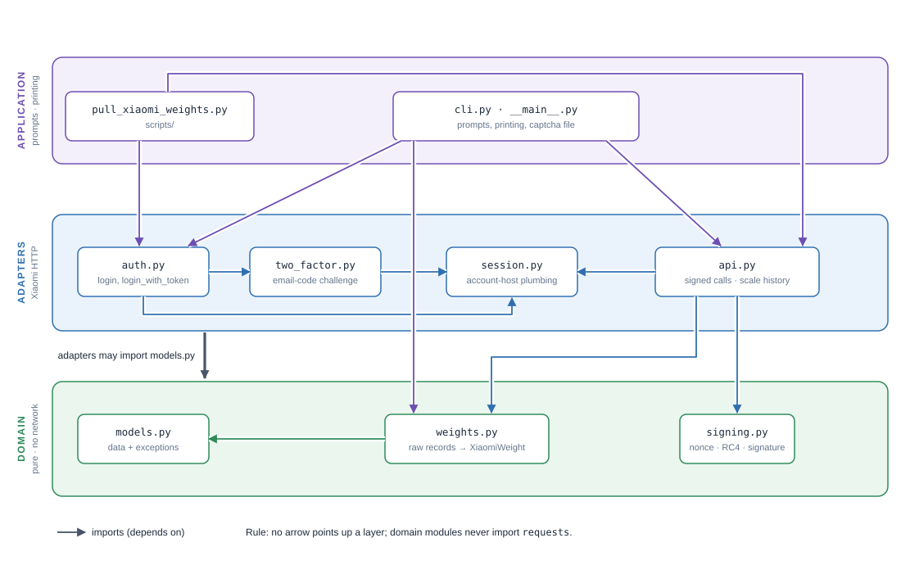
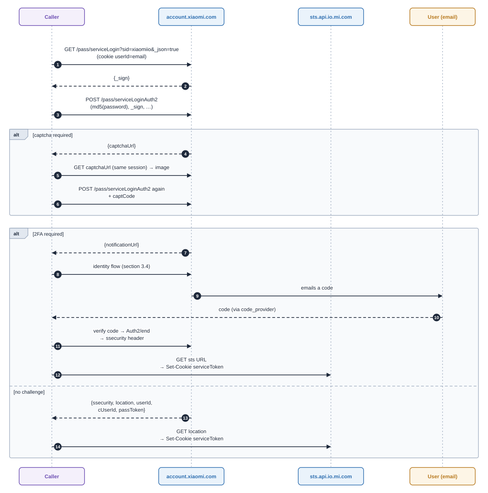

# Xiaomi Cloud Login And Scale Data: Design Record

**Status:** working implementation, validated offline (73 tests) and, in an earlier single-file form, against the live service. The restructured package has **not** been re-run live. See [Validation ledger](#4-validation-ledger).
**Scope:** obtain credentials for Xiaomi's unofficial cloud API from an email and password (including the captcha and email-code challenges), then fetch weight history for one Xiaomi scale model.
**Audience:** someone who needs to rebuild this, or extend it, without access to the conversation that produced it.

---

## 1. Principles (why)

### 1.1 Problem

The goal was to read personal weigh-in history from Xiaomi's cloud. Logging in through a browser works (email, password, then an emailed code), but a browser session yields no reusable credentials. The API wants a signed, encrypted request built from two secrets the browser never shows: `ssecurity` and `serviceToken`.

### 1.2 Constraints

| Constraint | Consequence |
|---|---|
| The API is unofficial and reverse-engineered | It can change without notice. Every protocol assumption below is labelled with its evidence. |
| The email code cannot be bypassed on a first login | Minimise how often it is needed (the `passToken` route, section 3.8) rather than trying to remove it. |
| Credentials are sensitive | Library code never prints, stores or logs them. Only the CLI presents them, masked by default. |
| This is an engineering project: correctness over convenience | Typed errors, input validation, no silent truncation, units documented. |
| Maintainability by one person | Small single-purpose modules; dependencies flow one way. |

### 1.3 Governing ideas

1. **Separate protocol from policy from presentation.** Signing is pure; the login flow is HTTP; prompts and printing live only in the CLI.
2. **Interaction is injected, not embedded.** The email code and the captcha text arrive through caller-supplied callables, so the same code serves a CLI, a test or an IMAP-reading automation.
3. **The durable credential is the `passToken`.** `ssecurity` and `serviceToken` are cheap to re-derive from it and should be treated as disposable.
4. **Evidence over assumption.** Several early hypotheses were wrong (section 3.9). The method that worked was: compare with a second independent implementation, run the narrowest live check, and only then build on the result.

---

## 2. Architecture (what)

### 2.1 Layers and dependency rule



*Figure 1. Purple arrows leave the application layer, blue arrows the adapter layer, green arrows the domain layer. The grey arrow means adapters may import `models.py`.*

**Rule:** an arrow never points up a layer. The domain layer must not import `requests`. This was checked mechanically (an AST walk over the package: no upward imports, no cycles, none of the domain modules import `requests`).

### 2.2 Modules

All under [`src/weight_up/xiaomi/`](../src/weight_up/xiaomi/).

| Module | Responsibility | Key public names |
|---|---|---|
| [models.py](../src/weight_up/xiaomi/models.py) | The package's public vocabulary: frozen data and the exception hierarchy | `XiaomiAuthResult`, `XiaomiWeight`, `XiaomiError` > `XiaomiAuthError`, `XiaomiApiError` |
| [signing.py](../src/weight_up/xiaomi/signing.py) | Nonce, key derivation, RC4, request signature, response decryption | `build_nonce`, `derive_signed_nonce`, `rc4_crypt`, `build_encrypted_params`, `decrypt_response` |
| [weights.py](../src/weight_up/xiaomi/weights.py) | Raw scale records to `XiaomiWeight` | `parse_scale_records` |
| [session.py](../src/weight_up/xiaomi/session.py) | Plumbing for the account host: endpoints, user agent, device cookies, guarded-JSON parsing, cookie lookup | `ACCOUNT_URL`, `SERVICE_ID`, `start_login_session`, `parse_response`, `find_cookie` |
| [two_factor.py](../src/weight_up/xiaomi/two_factor.py) | The email-code flow as small steps | `XiaomiEmailTwoFactorAuthenticator` |
| [auth.py](../src/weight_up/xiaomi/auth.py) | Login orchestration: sign, credentials, captcha, 2FA, token login | `login`, `login_with_token` |
| [api.py](../src/weight_up/xiaomi/api.py) | Everything that talks to the regional API host: one signed, encrypted POST, a credential check, paged scale history. Owns the region lists | `call_encrypted_api`, `verify_tokens`, `fetch_scale_records`, `fetch_weights`, `SCALE_REGIONS`, `API_REGIONS` |
| [cli.py](../src/weight_up/xiaomi/cli.py) | Presentation only. `__main__.py` is the three-line entry point for `python -m` | `main` |

Each module has one reason to change:

| Reason to change | Module |
|---|---|
| What the package returns, or how it fails | `models` |
| Xiaomi's request cryptography | `signing` |
| The format of a scale record | `weights` |
| The account-host login protocol | `session`, `two_factor`, `auth` |
| The API-host endpoints | `api` |
| What the user sees and is asked | `cli` |

### 2.3 Contracts

```python
login(email, password, code_provider: Callable[[], str],
      captcha_provider: Callable[[bytes], str] | None = None, logger=None) -> XiaomiAuthResult
login_with_token(user_id, pass_token, logger=None)                         -> XiaomiAuthResult
verify_tokens(auth_result, region, session=None)                           -> None   # raises XiaomiApiError
fetch_weights(auth_result, region, model, session=None)                    -> list[XiaomiWeight]
fetch_scale_records(auth_result, region, model, max_pages=500, session=None) -> list[dict]   # raw
parse_scale_records(records)                                               -> list[XiaomiWeight]
```

`XiaomiAuthResult` carries `ssecurity`, `service_token`, `user_id`, `c_user_id`, `pass_token`. Secret fields are excluded from `repr`, so logging the object cannot leak them.

### 2.4 Error model

Failure raises; success returns a complete result. There is no partial result and no `None` return.

| Raised | When | Typical message |
|---|---|---|
| `XiaomiAuthError` | Any login step fails | `serviceLogin did not return a _sign; check the email`, `Login rejected (code=...)`, `Captcha rejected; run again for a new one`, `Unable to determine the 2FA finish location; check the code`, `passToken rejected (result=...)` |
| `XiaomiApiError` | Signed call fails or cannot be decrypted | `... returned HTTP 401`, `response did not decrypt; ssecurity is probably wrong`, `... replied code=N message=...`, `Scale paging did not advance`, `Stopped after N pages` |
| `ValueError` | Programmer input is invalid, checked before any request | unknown region, empty model, missing `user_id`, empty email or password |

The meanings in the "typical message" column come from the code paths. The live service has been seen to produce only the success path and a captcha.

---

## 3. What we discovered (protocol facts)

Evidence key: **[live]** observed against the real service in this work; **[ref]** taken from a reference implementation, not independently observed; **[inferred]** deduced, unproven.

### 3.1 Services and hosts

- Login uses the **`xiaomiio`** service (the Mi Home service) **[live]**. Scale data accepts tokens issued for it **[live]**.
- Account host: `https://account.xiaomi.com`. Token hand-off host: `https://sts.api.io.mi.com/sts`.
- API host: `https://<region>.api.io.mi.com`, and `https://api.io.mi.com` for `cn` **[ref]**. The `sg` host answered **[live]**.
- Scale regions supported by the endpoint: `de`, `i2`, `ru`, `sg`, `us` **[ref]**.

### 3.2 Login sequence



*Figure 2. Dashed arrows are replies. The two `alt` frames are independent: a captcha may or may not appear, and the login then ends in either the 2FA branch or the no-challenge branch.*

Step 1: `GET /pass/serviceLogin?sid=xiaomiio&_json=true`, cookie `userId=<email>`. Before this, the session carries cookies `sdkVersion=accountsdk-18.8.15` and a random six-letter `deviceId` on both `mi.com` and `xiaomi.com`. The reply is JSON prefixed by `&&&START&&&` and contains `_sign` **[ref, live]**.

Step 2: `POST /pass/serviceLoginAuth2`, with every field in the **query string** (the body is empty), redirects disabled **[ref, live]**:

| Field | Value |
|---|---|
| `sid` | `xiaomiio` |
| `hash` | upper-case hex MD5 of the password |
| `callback` | `https://sts.api.io.mi.com/sts` |
| `qs` | `%3Fsid%3Dxiaomiio%26_json%3Dtrue` |
| `user` | the email |
| `_sign` | from step 1 |
| `_json` | `true` |
| `captCode` | only on the retry after a captcha |

The reply is one of: `captchaUrl`, `notificationUrl` (2FA), or `ssecurity` + `location` (+ `userId`, `cUserId`, `passToken`, `code`). Xiaomi code `87001` after a captcha retry means the captcha text was wrong **[ref]**.

### 3.3 Captcha

A captcha did appear on the first live attempt **[live]**. The image URL may be relative (prefix the account host). **The captcha is bound to the session that received it.** Fetch the image with that same session and resubmit from it. Solving a captcha in a browser does not clear it (this corrected an early wrong suggestion; see 3.9). The CLI saves the image to `xiaomi/captcha/` (created on demand, git-ignored) and asks for the text; the text is case-sensitive.

### 3.4 Email-code (2FA) flow

`notificationUrl` carries a `context` query parameter. All requests share the login session and send the form content type.

| # | Request | Notes |
|---|---|---|
| 1 | `GET notificationUrl` | Opens the identity flow. |
| 2 | `GET /identity/list` with `sid`, `context`, `_locale=en_US` | Lists verification options. |
| 3 | `POST /identity/auth/sendEmailTicket` | Query: `_dc` (ms), `sid`, `context`, `mask=0`, `_locale`. Form: `retry=0`, `icode=`, `_json=true`, `ick=<cookie ick>`. Triggers the email. A non-200 stops the flow. |
| 4 | Prompt for the code | `code_provider()`, trimmed. |
| 5 | `POST /identity/auth/verifyEmail` | Query: `_flag=8`, `_json`, `sid`, `context`, `mask=0`, `_locale`. Form: `_flag=8`, `ticket=<code>`, `trust=false`, `_json=true`, `ick`. |
| 6 | Find the finish location | In order: JSON `location`; else a `Location` header; else a regex over the body for `.../identity/result/check?...`; else `GET /identity/result/check` without redirects and read its `Location`. |
| 7 | `GET` the `result/check` URL, **no redirects** | Its `Location` is the `Auth2/end` URL. |
| 8 | `GET Auth2/end`, **no redirects** | The `extension-pragma` response header is JSON containing **`ssecurity`**. Sometimes a 200 "Xiaomi Account - Tips" HTML page comes first; repeat the request once. |
| 9 | `GET` the STS URL, redirects on | The URL is the `Location` header, or found in the body after `https://sts.api.io.mi.com/sts`. |
| 10 | Read cookie `serviceToken` on `.sts.api.io.mi.com` | This is the service token. Mirror it, as `serviceToken` and `yetAnotherServiceToken`, to `.api.io.mi.com`, `.io.mi.com` and `.mi.com`. |

The whole sequence worked live **[live]**. Step 6's fallbacks and the Tips-page repeat are inherited from the reference extractor and are covered by offline tests only. `userId` and `cUserId` come from the login reply, else from cookies on `.xiaomi.com` or `.sts.api.io.mi.com`. `passToken` is read from the cookie jar after the flow **[ref; see 3.8 for what is unproven]**.

### 3.5 What the credentials look like **[live]**

| Value | Observed shape |
|---|---|
| `ssecurity` | base64 string, 24 characters (a 16-byte key) |
| `service_token` | opaque string, about 190 characters |
| `user_id` | numeric string, 10 digits |
| `c_user_id` | populated; an opaque URL-safe string. Its meaning is **not documented anywhere we found**, and no API call here uses it. |

### 3.6 Signed request format

This is the part to reproduce exactly. All keys and nonces are base64 strings; `||` is byte concatenation.

```text
nonce         = base64( 8 random bytes || big-endian uint32( floor(unix_seconds / 60) ) )
signed_nonce  = base64( sha256( b64decode(ssecurity) || b64decode(nonce) ) )
rc4 key       = b64decode(signed_nonce);  discard the first 1024 keystream bytes

signature(params) = base64( sha1( "&".join(
                        [ "POST",
                          path_without_/app_prefix,        # "/app/x" signs as "/x"
                          "k1=v1", "k2=v2", ...,           # in insertion order
                          signed_nonce ] ) ) )

fields = { "data": <json text> }
fields["rc4_hash__"] = signature(fields)                   # over the PLAIN values
for each field:  value = base64( rc4(signed_nonce, utf8(value)) )
fields["signature"]  = signature(fields)                   # over the ENCRYPTED values
fields["_nonce"]     = nonce                               # plain
```

- Send `fields` as the **form-encoded POST body** (the app and the C# client do this). `ssecurity` itself is **never sent**. The Python reference extractor adds it to the request; we removed it, and the live scale call still succeeded **[live]**.
- Headers: `Accept-Encoding: identity`, a Mi Home style `User-Agent` (`<18 random letters>-<13 letters A–E> APP/com.xiaomi.mihome APPV/10.5.201`), form content type, `x-xiaomi-protocal-flag-cli: PROTOCAL-HTTP2` (the misspelling is Xiaomi's), `MIOT-ENCRYPT-ALGORITHM: ENCRYPT-RC4`, plus `MIOT-REQUEST-MODEL` on scale calls.
- Cookies: `userId`, `serviceToken`, `yetAnotherServiceToken`, and app constants `locale=en_GB`, `timezone=GMT+02:00`, `is_daylight=1`, `dst_offset=3600000`, `channel=MI_APP_STORE`.
- Response body: base64, RC4-decrypted with the **same** `signed_nonce` as the request, then JSON `{"code": 0, "message": ..., "result": ...}`. A body that does not decrypt to JSON almost always means a wrong `ssecurity`.
- `verify_tokens` calls `POST /app/v2/user/get_device_cnt` with `{"fetch_own": true, "fetch_share": true}`. A reply decrypting to `code 0` is the cheapest proof that the credentials work.

### 3.7 Scale data

`POST https://<region>.api.io.mi.com/app/eco/common/scale/getUserDataByPage` **[live, sg]**

```json
{"endTime":1,"beginTime":<now_ms>,"model":"<model>","uid":"<user_id as string>","did":0,"accountId":0}
```

with header `MIOT-REQUEST-MODEL: <model>`. The JSON text is compact (no spaces) and is signed exactly as sent.

- **Result:** a list of records `{model, uid, accountId, did, createTime (ms), data (JSON text), dataVersion, sn, fromSource}`. Newest first.
- **Paging:** 20 records per page **[ref]**. The next `beginTime` is the `createTime` of the 20th record of a full page; a short page is the last. The live run returned **402 records spanning 2025-09-13 to 2026-10-04 (UTC)** **[live]**, which exercised about 21 pages.
- **Open question:** whether `beginTime` is inclusive. If it is, the 20th record of each page repeats as the first of the next. The CLI prints `unique createTime` beside the record count so this can be checked on the next live run.
- **Record formats** (`fromSource`), parsed in [weights.py](../src/weight_up/xiaomi/weights.py):

| `fromSource` | Layout of `data` |
|---|---|
| 1 or 2 | JSON with measurements at the top level plus a `user` block. The device is `user.deviceId` for 2 and `reportFrom` for 1. Timestamp is the record's `createTime`. |
| 3 | JSON with string values `time`, `weight`, `bmi`, `heartRate`, `user`, and a **nested JSON string** `bodyResData` holding the body-composition fields. Timestamp is `time`. Device is the record's `did`. |
| other | Ignored. |

- **Field codes** (mapping inherited from the references; units not verified): `bfp` body fat, `bwp` body water, `bmc` bone mass, `ma` metabolic age, `slm` muscle mass, `pm` protein mass, `vfl` visceral fat, `bmr` basal metabolism, `sbc` body score, `smm` skeletal muscle mass, `bt` physique rating, `heartRate`. Only `weight` is documented as kilograms (the C# client names it `WeightKg`).
- **Model string** is required and account-specific. The C# tests use `yunmai.scales.ms104` (labelled S400) as an example; the live run used the user's own model.
- **China** uses a different endpoint (`/eco/scale/getData`) and is not implemented.

### 3.8 The `passToken` route

The C# reference client is built around `login_with_token(user_id, pass_token)`:

1. `GET /pass/serviceLogin?_json=true&sid=xiaomiio` with cookies `userId` and `passToken`.
2. A reply with `"result": "ok"` carries a fresh `ssecurity`, `location` and (possibly) a new `passToken`.
3. `GET location` sets the service cookies.

No password and no email code are involved. This is implemented in `login_with_token` and tested offline. **It has not been run live.** Two things are unproven: that the cookie jar really holds a `passToken` after the 2FA flow (the user ran with `--show-pass-token` and a token entry now exists in `.env`, which suggests yes, but we have not seen the capture), and that Xiaomi accepts it without a code. The token's lifetime is unknown.

### 3.9 Hypotheses that were wrong or changed

| Early belief | What we found | Evidence |
|---|---|---|
| "Solve the captcha in a browser, then retry." | The captcha is session-bound; it must be solved in the script's session. | Reference extractor fetches and solves in-session. |
| The weight data needs the Mi Fitness service (`miothealth`, `hlth.io.mi.com`). | It comes from the Mi Home route (`xiaomiio`, `<region>.api.io.mi.com`). | C# client and every caller use `xiaomiio`; live scale fetch succeeded. |
| Send `ssecurity` as a request field, as the Python reference does. | Not needed, and sending a secret key is avoidable. | C# client omits it; live scale fetch succeeded without it. |
| Put `data` in the query string. | The app uses the POST body. | C# client; live scale fetch succeeded with the body. |
| Capture traffic from the Xiaomi Home app. | HTTP Toolkit failed: certificate rejected for `sg.core.api.io.mi.com`, `sg.api.io.mi.com`, `sg.home.mi.com`, `api.account.xiaomi.com`, `tracking.intl.miui.com`. | Probably certificate pinning or an untrusted user CA. The capture held hostnames only; nothing was implemented from it. |

Open: `api.account.xiaomi.com`, `sg.core.api.io.mi.com` and `sg.home.mi.com` were seen but their roles are unknown.

---

## 4. Validation ledger

| Claim | Status | Evidence |
|---|---|---|
| Email + password + captcha + email code produces `ssecurity` and `serviceToken` | **Live** | User's run, single-file version |
| Signed `get_device_cnt` on `sg` returns `code 0` | **Live** | `verification: PASS` |
| Signed scale fetch returns data | **Live** | 402 raw records, 2025-09-13 to 2026-10-04 UTC |
| Request signing is correct | **Live + offline** | Live success; test cross-checks an independent re-implementation of the C# algorithm |
| Weight parsing equals the previous parser | **Offline** | Characterisation against the old code on 5 records incl. `None` values |
| Package, tests, CLI after the restructure | **Offline only** | 73 tests; not run against Xiaomi since the split |
| `login_with_token` without an email code | **Unverified** | Next live test |
| `passToken` present in the jar after 2FA | **Unverified** | Inferred from the user's `.env` |
| Boundary duplicates between pages | **Unverified** | CLI prints `unique createTime` |
| Parsed weight values and units | **Unverified** | Counts were printed live; values were never compared with the app |
| Token lifetime and expiry behaviour | **Unknown** | |
| `trust=true` removes the email code on later logins | **Untried** | |

---

## 5. Decisions and rejected alternatives

| # | Decision | Why | Rejected alternative |
|---|---|---|---|
| D1 | Python with `requests` and `pycryptodome` (already dependencies) | No new dependencies; fits the repo | `httpx`, an RC4 reimplementation (the C# one is hand-rolled; not worth it) |
| D2 | Pure `signing.py`; the caller supplies randomness and the clock | Testable with fixed inputs; no hidden state | Calling `os.urandom`/`time` inside signing |
| D3 | Raise typed exceptions | "Fail early; return meaningful errors." A login that returns `None` hides the cause | Return `None` and log (the first version did this) |
| D4 | Code and captcha arrive as callables | Keeps UI out of the protocol layer; allows IMAP-driven codes later | `input()` inside the flow (the reference extractor does this) |
| D5 | `passToken` is the persistent credential, kept outside the repo (`.env` is git-ignored) | Re-derives the short-lived tokens without 2FA (if proven) | Persisting `ssecurity`/`serviceToken` |
| D6 | The library never persists or prints secrets; `--show-pass-token` is opt-in; the token is read from an environment variable or a hidden prompt, never from `argv` | Process listings and shell history leak arguments | A `--pass-token` flag |
| D7 | Secret fields hidden from `repr` | Logging a result object cannot leak it | Relying on callers to be careful |
| D8 | Validate `region` against a fixed list before building a hostname | Prevents sending tokens to an arbitrary host | Interpolating the region unchecked |
| D9 | Raw records and parsing are separate | The transport can be verified without trusting the parser | One function that fetches and parses |
| D10 | Paging errors instead of truncating | "Avoid silently ignoring failures." | A silent page limit |
| D11 | Dropped the Mi Fitness (`miothealth`) path and the old `AuthMixin`/`Client` | Unverified, and the working route is `xiaomiio` | Keeping it as a stub (offered; the user chose removal) |
| D12 | Kept the name `auth.py` for login orchestration | Existing mental model and import path | Renaming to `login.py` |
| D13 | Did not adopt the reference extractor wholesale | It parses command-line arguments at import time, holds global state and mixes prompting with protocol | Copying it and trimming |
| D14 | Rejected: browser automation, MITM capture, IMAP now | Automation is heavy and brittle; capture failed (3.9); IMAP is possible later through `code_provider` | |
| D15 | Consolidated from 12 modules to 8 (14 files to 10) after review. `cloud_api`, `scale` and `client` became `api.py` | Each was imported by one or two others and the layer diagram had about 15 arrows. They share one responsibility, talking to the API host, and one reason to change | Keeping three files; collapsing everything into one (the 779-line version was harder to read and test) |
| D16 | Removed the `XiaomiScaleClient` class; `fetch_weights(auth, region, model)` replaces it | The class wrapped two calls and had one caller. Inputs are now validated at call time, still before any request | Keeping the class for construct-time validation |
| D17 | Exceptions moved into `models.py`; endpoint constants moved into the module that uses them (`session.py` for the account host, `api.py` for regions) | A 13-line file each, imported by most modules, with no behaviour of its own | Absorbing the helpers into `auth.py`: `two_factor.py` needs them and `auth.py` imports `two_factor.py`, which would be a cycle |
| D18 | Kept `signing`, `weights`, `two_factor` and `cli` as separate modules despite the pressure to merge | `signing` and `weights` are pure and tested against an oracle; `two_factor` is a separate protocol (the identity service) with about twelve steps; `cli` is the only code that prompts or prints. Merging `two_factor` into `auth` gives a 470-line module with two protocols | A single `login.py` |

### Assumptions

- A single personal account; the user knows their scale model.
- The email code is the only second factor in play.
- The user's region is one of the five scale regions.
- Xiaomi's behaviour matches the reference implementations closely enough; nothing here is documented by Xiaomi.

### Non-goals

Mi Fitness data, the China scale endpoint, device discovery or listing, storing weights, automatic token refresh and fallback to a full login, and handling more than one account.

---

## 6. Implementation guide (how)

### 6.1 Build order that worked

1. **Signing first**, with tests against an independent implementation of the same algorithm (the C# client). This is the highest-risk code and has the cheapest oracle.
2. **Weight parsing**, pure, with synthetic records for each `fromSource`.
3. **Login steps** with a scripted fake session (a table of `(method, URL fragment) → response`).
4. **2FA** as small methods; reproduce the fallbacks, then test each.
5. **One signed call** and `verify_tokens`.
6. **Scale paging.**
7. **CLI**, then the pull script.
8. **Run live** at each of: login, `verify_tokens`, scale fetch. Do not build the next layer on an unverified one.

### 6.2 Test strategy

Tests live in [tests/xiaomi/](../tests/xiaomi/), a package, so modules import the fakes relatively. Run `python -m pytest tests -q`.

| File | Covers |
|---|---|
| `test_xiaomi_signing.py` | nonce layout, key derivation, RC4 discard, C#-algorithm cross-check, `ssecurity` never in the fields, wrong key rejected |
| `test_xiaomi_weights.py` | each source type, defaults, malformed record index, immutability |
| `test_xiaomi_two_factor.py` | success, ticket failure stops before the prompt, each fallback, Tips page, missing `ssecurity`, STS without cookie |
| `test_xiaomi_auth.py` | hash and `_sign`, captcha success/rejection/blank/no-solver, rejected credentials, unreadable reply, token login success and expiry |
| `test_xiaomi_api.py` | request shape, region validation, error mapping, paging cursor, stalled cursor, page limit, `fetch_weights` |
| `test_xiaomi_cli.py` | argument rules, secrets never printed, captcha folder created on demand |

Techniques worth repeating:

- **Fakes, not patched `requests`.** A `FakeSession` answers from a route table; an `EncryptedApi` fake actually decrypts the request and encrypts the reply, so signing and transport are tested together.
- **Independent oracle.** The signing test re-implements the C# string-building by hand.
- **Characterisation before refactoring.** Old and new parsers were run on the same inputs. The D15 consolidation reused the existing tests, changing only imports and the two tests that exercised the removed client class.
- **Mutation spot-checks.** Four deliberate bugs (lower-case hash, wrong paging cursor, fields in the query string, unchecked region) were each caught, including after the D15 consolidation. If you do this, clear `__pycache__` between runs: a same-size edit in the same second left a stale bytecode file that briefly made a healthy suite look broken.

### 6.3 Running it

```text
# first login, with email code (and captcha if asked); prints masked credentials
python -m weight_up.xiaomi EMAIL -r sg --model MODEL --show-pass-token

# later logins from a saved passToken (no password, expected to need no code)
XIAOMI_PASS_TOKEN=... python -m weight_up.xiaomi --user-id USER_ID -r sg --model MODEL

# export history (reads XIAOMI_USER_ID, XIAOMI_PASS_TOKEN, XIAOMI_SCALE_MODEL from .env)
python scripts/pull_xiaomi_weights.py --region sg
```

`python -m` is required: the modules use relative imports, so running `auth.py` directly no longer works.

### 6.4 Extending it

| Goal | Where |
|---|---|
| Read the email code automatically | Pass an IMAP-reading callable as `code_provider`; no protocol change |
| Expire handling | Catch `XiaomiAuthError` from `login_with_token`, fall back to `login`, store the new `passToken` |
| Another endpoint | Call `call_encrypted_api` from `api.py` with a new path and body; keep parsing in a pure module |
| China scale data | Add `/eco/scale/getData` (different body shape) to `api.py` |
| Device listing, to find the model | `v2/homeroom/gethome` and `v2/home/home_device_list` appear in the reference extractor |

---

## 7. Security notes

- Treat `ssecurity`, `service_token` and `pass_token` as passwords. The CLI masks them by default and the library never writes them.
- Git-ignored paths added: `.env` (already), `src/weight_up/xiaomi/captcha/`, `data/xiaomi_weights.json`. The last one was **not** ignored before this work, and would have exposed weight history.
- The password is sent only as an upper-case MD5, as Xiaomi's login requires. MD5 is weak; this is the service's choice, not ours.
- `ssecurity` is not transmitted in API calls (3.6). An early verification step did send it; it was removed.
- Region is validated before any hostname is built (D8).
- Account identifiers (email, user id) appeared in the working conversation. They are deliberately absent from this document and from the tests.

---

## 8. Open questions and next steps

1. Run `login_with_token` live. If it needs no code, the persistence design is confirmed.
2. Check `unique createTime` against the record count to settle the paging-boundary question.
3. Compare a handful of parsed weights with the Xiaomi app to verify units and field codes.
4. Implement expiry fallback, then decide how the new `passToken` is stored.
5. Try `trust=true` in `verifyEmail` as a way to reduce future codes.
6. Establish the token's lifetime by observation.
7. Decide whether to keep `tmp/token_extractor.py`; it is a reference only and nothing imports it.
8. Prune the inherited 2FA fallbacks (the body regex, the `result/check` fallback, the Tips-page repeat, the STS-from-body scan) and the unobserved no-challenge login branch. Do it with evidence: log which branch fires during a live run, then delete those that never did. Deleting them blind risks breaking a path the live service uses.

---

## 9. Sources

| Source | Used for |
|---|---|
| [`tmp/token_extractor.py`](../tmp/token_extractor.py) (Xiaomi-Cloud-Tokens-Extractor style) | Login steps, captcha handling, the 2FA flow, signing, the device-count call |
| `third-party/XiaomiScale/.../YetAnotherXiaomiCloudClient/XiaomiClient.cs` | Token login, scale endpoint and body, paging, record formats, request body placement |
| `third-party/XiaomiScale/Services/XiaomiService.cs` and its tests | Confirmation that every caller uses `xiaomiio`; an example model string |
| [`references/xiaomi-go/`](../references/xiaomi-go/) | Present in the repository; not consulted in this work |
| The user's own runs | Everything marked **[live]** |
